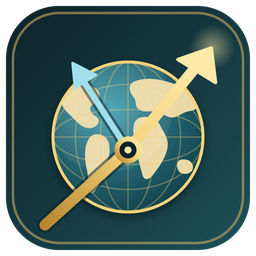

# AltHistory

**Альтернативная история твоей жизни** — симулятор жизни с нейросетью, которая работает прямо на твоём ПК.

Родись в 2018-м, 2026-м или 1936-м, учись, влюбляйся, открывай бизнес, строй карьеру до президента — пиши в чат, что делает твой герой, а нейросеть и живой мир решат, что из этого выйдет. Мультиплеер с друзьями, 3D-город с твоим домом, война и политика на карте мира.

## Скачать

👉 **[Последняя версия — раздел Releases](https://github.com/pavlenkovilyay-cmd/AltHistory/releases/latest)** → файл `AltHistory-Setup-…exe`.

1. Запусти установщик. Windows может сказать «Windows защитил ваш компьютер» — нажми «Подробнее» → «Выполнить в любом случае» (у игры нет платной подписи).
2. Выбери папку, оставь галочку «Ярлык на рабочем столе».
3. В лаунчере выбери нейросеть — она скачается сама при первом запуске (2,5–5 ГБ).

Обновления приходят сами: когда выходит новая версия, в лаунчере загорается кнопка **«⬆ ОБНОВЛЕНИЕ»**.

## Что нового в 3.6

- **3.6.1**: исправлены ошибка обновления «Invalid package» и войны, которые сами заканчивались через пару недель.

- **Нейрочат точнее и быстрее**: «повышение», «ультиматум», «вооружаем банду», «митинг», «революция» и другие однозначные фразы понимаются сразу, без лишнего запроса к нейросети.
- **Ультиматумы** другим странам (и от ботов — вам), **протесты, забастовки, революции, дворцовые перевороты, вооружённые восстания** и 7 способов их подавить.
- **Страны-боты живут сами**: торговля, санкции, помощь, военные союзы, инциденты, перевороты.
- **Окно «Моя ОПГ»**: оружие, тренировки, верность, разборки, отделение региона. **Схемы мошенничества** — понятные и чуть легче.
- **Армия**: от отделения до дивизий на карте — окно «Моя часть».
- **Репутация**: понятное окно и способы поднять без должности.
- **Карта с рельефом** гор и возвышенностей.
- **3D-город вдвое больше**: хрущёвки, панельки и элитный ЖК с квартирами на 1–6 комнат, бедные/обычные/двухэтажные богатые дома, парк с прудом, школа со стадионом, супермаркет с заправкой, гаражи, детские площадки, парковки. **Своя машина** стоит у подъезда — на ней можно ездить, друг может сесть за руль или пассажиром.

## Требования

- Windows 10/11, 64-бит
- Видеокарта с 6+ ГБ памяти (для «Умной» нейросети — 8+ ГБ), подойдёт и процессор, но медленнее
- ~6 ГБ на диске
